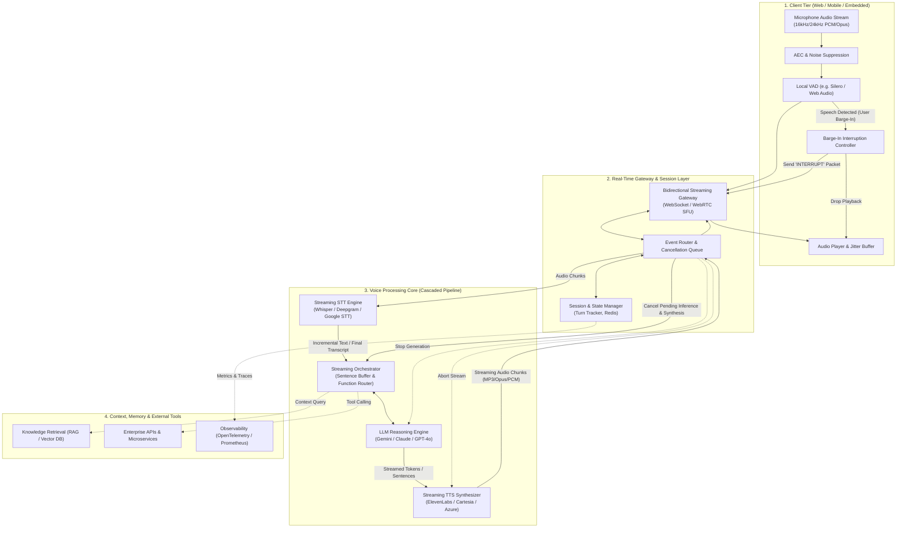
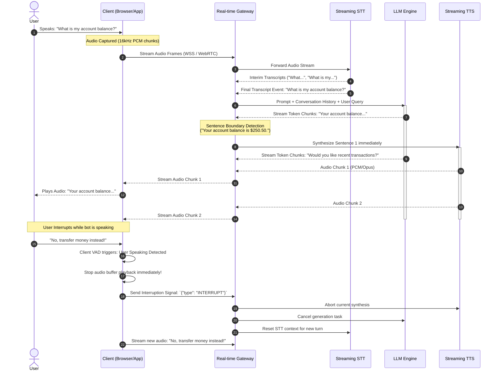
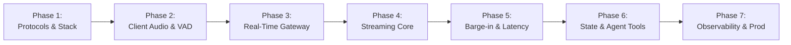

# Voice Chatbot Architecture & Implementation Blueprint

**Document Version:** 1.0.0  
**Author:** Senior Software Architect  
**Status:** Approved / Architecture Design Document (ADD)  
**Target Latency:** Sub-800ms End-to-End (Voice-in to Audio-out)

> **Scope note:** This document is the **production target architecture**. It is **not part of the 8-hour PoC build**. The PoC is specified in [interview_voice_bot_poc.md](interview_voice_bot_poc.md); use this document as the reference for how the PoC would scale (Q1 and Q4 in the PoC's interview-defense section).

---

## 1. Executive Summary

This document specifies the end-to-end architecture, technical components, data flows, and phased implementation steps for building an enterprise-grade, ultra-low-latency **Voice Chat Bot**. 

Modern voice bots must move beyond clunky half-duplex (walkie-talkie) IVR systems to achieve **natural, full-duplex conversational AI**. This requires:
1. **Streaming Audio Ingestion & Playout:** Using real-time bidirectional protocols (WebSockets / WebRTC).
2. **Client-Side Voice Activity Detection (VAD) & Barge-in:** Immediate local interruption when the user speaks while the bot is outputting audio.
3. **Pipelined Streaming Execution:** Overlapping Speech-to-Text (STT), Large Language Model (LLM) token generation, and Text-to-Speech (TTS) synthesis to minimize Time-to-First-Audio (TTFA).

---

## 2. High-Level System Architecture

The system is decoupled into four primary tiers:
1. **Client Tier (Edge / Frontend):** Audio capture, noise suppression, acoustic echo cancellation (AEC), client-side VAD, and jitter-buffered audio playback.
2. **Real-Time Gateway & Session Orchestrator:** Manages bidirectional WebSocket/WebRTC connections, session state, message routing, and backpressure.
3. **Conversational AI Engine (Cascaded or Multimodal):** 
   - **Cascaded Pipeline:** Streaming STT $\rightarrow$ LLM Reasoning Engine $\rightarrow$ Streaming TTS.
   - **Native Multimodal Voice (Alternative):** Direct Speech-to-Speech (S2S) via WebRTC/Live API.
4. **Data, Memory & Integrations:** Fast session cache (Redis), Vector DB for Knowledge/RAG, and External Tool/API execution.

### Architectural Diagram

---

## 3. End-to-End Sequence & Data Flow

Below is the detailed sequence showing a complete conversational turn, including audio chunk streaming, sentence boundary chunking, and immediate barge-in interruption.

---

## 4. Latency Budget Analysis (Target: Sub-800ms)

To achieve human-like conversation cadence, latency must not exceed 800ms. The critical metric is **Time to First Audio (TTFA)**.

| Stage | Component | Typical Latency | Optimization Strategy |
| :--- | :--- | :--- | :--- |
| **Ingress** | Network Audio Stream | 30ms - 60ms | WebSocket / WebRTC with binary Opus frames |
| **STT** | Endpointing & Transcription | 120ms - 200ms | Streaming STT with interim results & aggressive endpoint detection |
| **Orchestration** | Context injection & Prompt assembly | 10ms - 25ms | In-memory Redis cache for chat history |
| **LLM TTFB** | Time-to-First-Token | 150ms - 250ms | Fast streaming models, speculative decoding, short system prompts |
| **Sentence Chunking** | Delimiter detection | 0ms - 15ms | Dispatch to TTS on first punctuation mark (`.`, `?`, `!`, `,`) |
| **TTS TTFB** | Audio Synthesis First Frame | 80ms - 150ms | Ultra-fast low-latency TTS providers (WebSocket streaming API) |
| **Egress** | Audio Streaming to Client | 30ms - 50ms | Immediate chunk playout over jitter buffer |
| **Total TTFA** | **End-to-End** | **~420ms - 750ms** | **Parallelized pipelining** |

---

## 5. Architectural Decision Records (ADRs)

### ADR 1: Cascaded Pipeline vs. Native Multimodal Speech-to-Speech (S2S)
* **Decision:** Default to a **Cascaded Modular Pipeline** (Streaming STT $\rightarrow$ LLM $\rightarrow$ Streaming TTS) with an abstraction layer supporting **Native Multimodal S2S** (e.g., Gemini Live API).
* **Rationale:**
  * Cascaded allows swapping individual best-in-class components (e.g. Deepgram for STT, Claude/Gemini for LLM, ElevenLabs/Cartesia for TTS).
  * Enables granular guardrails, deterministic PII redaction, and tool-calling interception before audio synthesis.
  * Multimodal S2S can be toggled for applications prioritizing emotional inflection and sub-400ms latency.

### ADR 2: Transport Protocol — WebSockets vs. WebRTC
* **Decision:** **WebSockets (Binary framing)** for general web/mobile clients; **WebRTC (DataChannels + MediaTracks)** for ultra-low latency carrier/telephony integration.
* **Rationale:** WebSockets offer simpler infrastructure, firewall traversal, and horizontal scaling behind standard reverse proxies (NGINX/Envoy), while WebRTC is optimal for UDP-based loss-tolerant real-time media.

### ADR 3: Voice Activity Detection (VAD) & Barge-in Placement
* **Decision:** **Hybrid VAD** (Client-side edge VAD for instant audio muting + Server-side VAD for authoritative turn completion).
* **Rationale:** Client-side VAD (e.g., Silero VAD running in WASM / WebWorker) drops the speaker immediately upon user speech without waiting for network roundtrip, preventing echo and user frustration.

---

## 6. Step-by-Step Implementation Roadmap

The implementation is broken down into 7 chronological phases:

### Phase 1: Environment, Protocol & Technology Stack Setup
1. **Define Audio Specifications:**
   - Sample rate: 16,000 Hz or 24,000 Hz, 1 channel (mono), 16-bit linear PCM or Opus codec.
   - Frame chunk duration: 20ms to 50ms per audio frame.
2. **Select Core Infrastructure:**
   - **Backend:** Node.js / TypeScript (Fastify/ws) or Python (FastAPI/asyncio) or Go.
   - **Transport:** WebSocket Server with binary support and JSON control frames.
   - **Storage:** Redis (Session state, active turn metadata, context window).

### Phase 2: Client-side Audio I/O & VAD Pipeline
1. **Audio Capture Pipeline:**
   - Utilize `navigator.mediaDevices.getUserMedia` with:
     * `echoCancellation: true`
     * `noiseSuppression: true`
     * `autoGainControl: true`
2. **Audio Worklet Processor:**
   - Implement `AudioWorkletNode` for zero-lag buffer processing off the main UI thread.
   - Downsample raw input to 16kHz PCM.
3. **Edge VAD Integration:**
   - Integrate lightweight VAD (e.g., Silero VAD in ONNX runtime Web) to detect voice onset and pause duration (silence threshold: ~400ms to 600ms).

### Phase 3: Real-Time Bidirectional Gateway
1. **Connection Lifecycle:**
   - Handle client handshake with authentication (JWT/API Key).
   - Establish dedicated upstream WebSocket session for audio and control frames.
2. **Frame Multiplexing Protocol:**
   - **Binary Frames:** Raw audio packets.
   - **JSON Control Frames:** Session start, user transcript, assistant transcript delta, interruption event, error handling.
3. **Session State Store:**
   - Store conversation turn history, active cancellation tokens, and connection metadata.

### Phase 4: Core Brain: Streaming STT, LLM & TTS
1. **Streaming STT Integration:**
   - Pipe incoming audio stream directly into STT WebSocket API.
   - Handle both `is_final: false` (real-time UI captions) and `is_final: true` (turn execution).
2. **LLM Streaming & Sentence Chunking:**
   - Initiate LLM streaming completion immediately upon STT finalization.
   - Implement a **Sentence Boundary Aggregator**:
     * Buffer streamed tokens until sentence terminators (`.`, `?`, `!`, `\n`) are reached.
     * Emit sentence chunk immediately to TTS without waiting for the full LLM response.
3. **Streaming TTS Integration:**
   - Send sentence chunks concurrently to TTS streaming WebSocket.
   - Pipe resulting audio frames straight back down the gateway to the client.

### Phase 5: Barge-in, Interruption & Audio Playback
1. **Barge-in Logic:**
   - When client VAD detects user speech during assistant playback:
     1. Client immediately halts audio player and flushes the buffer.
     2. Client emits `{"type": "INTERRUPT"}` frame to Gateway.
     3. Gateway cancels ongoing LLM token generation (via AbortController).
     4. Gateway closes or aborts TTS synthesis stream.
     5. Gateway updates conversational state with the truncated assistant response.
2. **Client Audio Playout & Jitter Buffer:**
   - Web Audio API `AudioContext` with queued `AudioBufferSourceNode` chunks or SourceBuffer in MediaSource extensions.

### Phase 6: Conversational Memory, RAG & Function Calling
1. **Sliding Window Context:**
   - Maintain summary + last $K$ turns in Redis to balance context relevance and prompt processing latency.
2. **Voice-Optimized Prompting:**
   - System prompts tuned for spoken responses: concise sentences, no markdown symbols (asterisks, tables, bullet points), natural conversational cues.
3. **Streaming Tool Calling:**
   - Detect tool call invocations, synthesize brief filler speech ("Let me check that for you...") while fetching data asynchronously.

### Phase 7: Observability, Resilience & Production Deployment
1. **Distributed Tracing & Metrics:**
   - OpenTelemetry spans tracking:
     * Audio Ingress $\rightarrow$ STT final latency
     * STT final $\rightarrow$ LLM First Token
     * LLM First Chunk $\rightarrow$ TTS First Audio
     * Complete Turn Duration
2. **Fallback & Graceful Degradation:**
   - Failover TTS provider if primary exceeds timeout threshold.
   - Reconnect strategies with exponential backoff on WebSocket drops.
3. **Containerization & Deployment:**
   - Containerize gateway with Docker.
   - Deploy behind Kubernetes or cloud container instances with sticky sessions or Redis-backed state coordination.

---

## 7. Security, Privacy & Compliance

1. **In-Transit Encryption:** All streams secured via WSS (WebSocket Secure) and TLS 1.3.
2. **Audio Data Privacy:**
   - Ephemeral memory processing: Audio frames discarded from RAM immediately after transcription.
   - Zero-retention agreements with external STT/LLM/TTS vendors where regulatory compliance (HIPAA, GDPR) is required.
3. **PII Masking:** Real-time entity redaction on transcripts prior to external vector database persistence.

---

## 8. Summary Checklist for Implementation

| Milestone | Deliverables | Verification Criteria |
| :--- | :--- | :--- |
| **M1: Audio Transport** | Client AudioWorklet + Gateway WSS | Bidirectional binary streaming with < 50ms overhead |
| **M2: STT Pipeline** | Streaming STT integration | Live transcript stream with < 200ms endpointing |
| **M3: LLM + Sentence Parser**| Token streaming + Sentence chunker | First sentence dispatched to TTS within 250ms of STT completion |
| **M4: TTS Playout** | TTS audio streamer + Client jitter buffer | Smooth continuous playback with no stuttering/clicks |
| **M5: Barge-in** | Client VAD + AbortController cancel loop | Audio cuts off instantly (< 80ms) upon user speech |
| **M6: Voice Polish & Tools** | System prompt tuning + Tool calling | Spoken responses natural without robotic markdown formatting |
| **M7: Production Monitoring** | OpenTelemetry dashboards | Alerting on TTFA > 1000ms and connection drop spikes |

